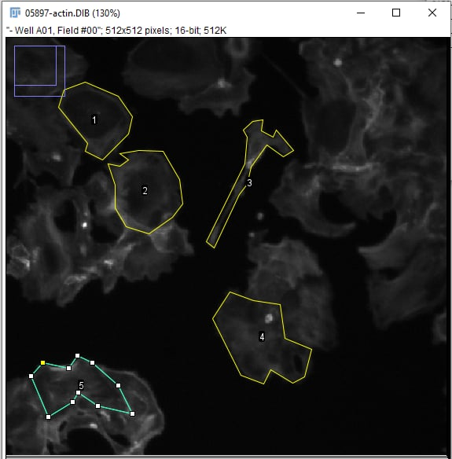
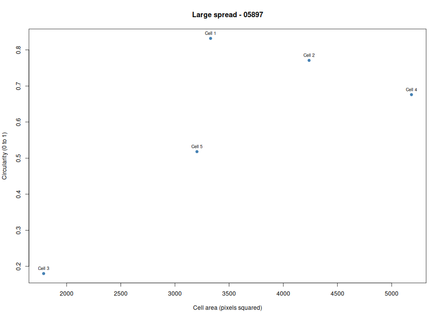
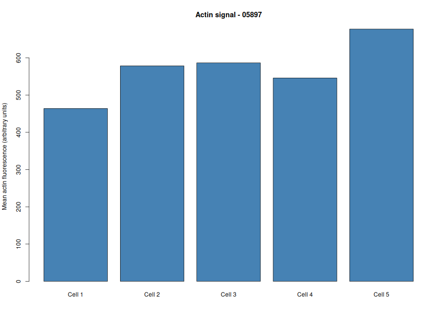

# Cytoskeleton and Cell Morphology (BBBC018)

---

## 1. Image Information

| Item | Details |
|---|---|
| Student ID | 202400729 |
| Chosen phenotype | Large spread |
| Image field ID | 05897 |
| Actin file | 05897-actin.DIB |
| DNA file | 05897-DNA.DIB |
| Dataset page | https://bbbc.broadinstitute.org/BBBC018 |
| Download link | https://data.broadinstitute.org/bbbc/BBBC018/BBBC018_v1_images.zip |

---

## 2. Brief Fiji Steps

1. I opened 05897-actin.DIB and 05897-DNA.DIB in Fiji using File > Import > Bio-Formats.
   
2. In Analyze > Set Measurements, I checked Area, Mean gray value, Shape descriptors and Display label. Limit to threshold stayed unchecked.
   
3. I opened Analyze > Tools > ROI Manager.
   
4. I traced five cells on the actin image with the polygon tool. I used the DNA image to check the nuclei.
   
5. For each cell I pressed T to add it to ROI Manager, then M to measure it.
    
6. I saved the Results table as data/fiji_results.csv and the traced cells as figures/measured_cells.png. The original DIB images were not changed.

---

## 3. Results

### Measurements per cell

| Cell | Area (px²) | Mean actin | Circularity | Aspect ratio |
|---|---|---|---|---|
| 1 | 3329 | 463.82 | 0.832 | 1.399 |
| 2 | 4238 | 578.30 | 0.771 | 1.193 |
| 3 | 1788 | 586.42 | 0.180 | 4.160 |
| 4 | 5183 | 545.77 | 0.676 | 1.644 |
| 5 | 3203 | 677.19 | 0.518 | 1.986 |

### Mean of the five cells

| Mean area (px²) | Mean circularity | Mean aspect ratio | Mean actin signal |
|---|---|---|---|
| 3548 | 0.60 | 2.08 | 570.3 |

Area is in pixels² because no calibration was given. Actin intensity is in arbitrary units and should not be compared with other image fields.

---

## 4. Figures

**Figure 1.** The five cells I traced on 05897-actin.DIB with the polygon tool. Each outline is numbered 1 to 5 in ROI Manager.

**Figure 2.** Cell area (pixels²) against circularity for the five cells. Cell 1 was the roundest (0.83). Cell 3 had the smallest area (1788) and the lowest circularity (0.18) because I traced a long thin projection. Cell 4 was the largest (5183).

**Figure 3.** Mean actin fluorescence of each cell in arbitrary units. Cell 5 had the highest signal (677) and cell 1 the lowest (464).

---

## 5. Answers

**1. Which phenotype did you choose, and what visible features support it?**

I chose Large spread. The cells in this field look big and flat, with wide, ruffled edges instead of small round shapes.

**2. Were your five cells mostly round or elongated?**

They were mixed. Cells 1 and 2 were fairly round (circularity 0.83 and 0.77). Cell 3 was very elongated (circularity 0.18, aspect ratio 4.16) because I traced a long thin projection. The mean circularity was 0.60 and the mean aspect ratio was 2.08.

**3. What role does actin play in cell shape and movement?**

Actin filaments form a network under the plasma membrane that supports the shape of the cell. During movement, actin builds up at the front edge and pushes the membrane forward to make protrusions.

**4. Why can a single fixed fluorescence image NOT show how fast a cell moves?**

A fixed image is only one moment in time. To measure speed, you need to follow the same cell over several time points and see how far it moved.

---

## 6. Notes

Some cells in this field touch their neighbors, so I traced the clearest edge of each cell.

---

## 7. Repository Files

| File | Description |
|---|---|
| data/fiji_results.csv | Fiji measurements of the five cells |
| scripts/analyze_cells.R | R script that makes the summary and plots |
| results/cell_summary.csv | Mean values of the five cells |
| figures/measured_cells.png | Traced cells |
| figures/area_vs_circularity.png | Area vs circularity plot |
| figures/actin_intensity.png | Actin intensity plot |

---

## 8. Data Credit

We used image set BBBC018v1 from the Broad Bioimage Benchmark Collection (Ljosa et al., Nature Methods, 2012).
The images are licensed CC BY-NC-SA 3.0.
